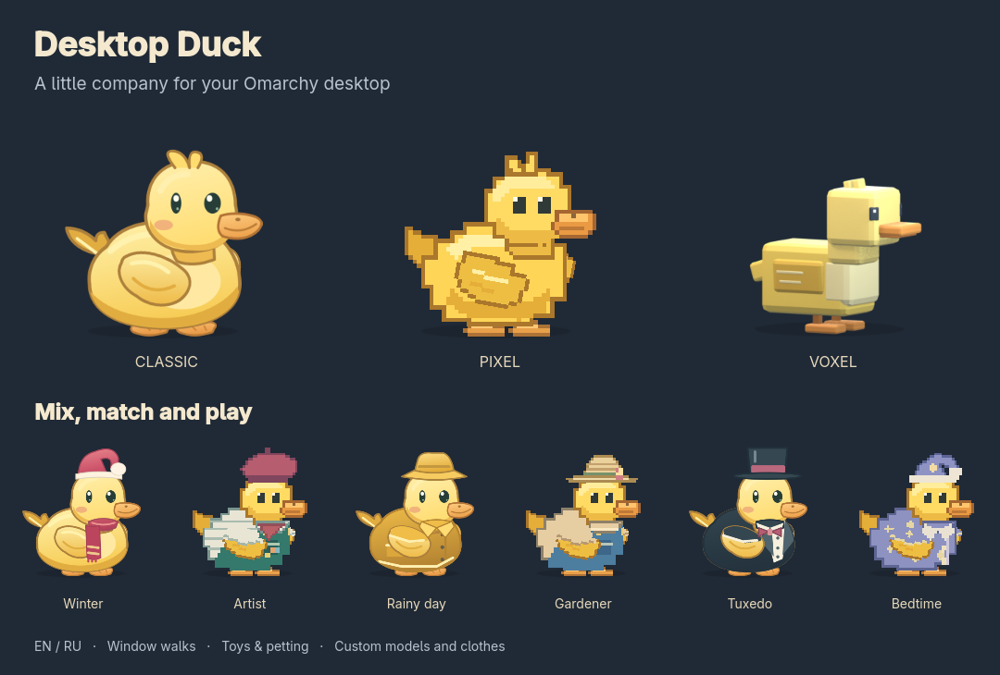

# Desktop Duck

An interactive desktop companion for **Omarchy Quattro and Hyprland**.
Walk along window edges, place food, throw a ball, pet your duck, and mix
outfits across classic, pixel and Blender-rendered voxel models.

**1.0.0 — first public release.**

[](https://github.com/ditrigo/omarchy-desktop-duck/actions/workflows/checks.yml)

[Русский](docs/ru/README.md) · [Art studio](ART-TOOL.md) ·
[Contributing](CONTRIBUTING.md) · [Changelog](CHANGELOG.md)



## Requirements

- Omarchy Quattro with `qs.Ui`, `qs.Commons.Translations` and the shell plugin API.
- Hyprland, Quickshell and Qt Quick, supplied by Omarchy.
- Optional: `pw-play` from `pipewire-audio` for quacking. Sound is off by default.

The runtime uses prebuilt SVG/PNG assets. Python, Node, uv and Blender are
**development tools**, not requirements for keeping the duck on your desktop.
The full verification suite is run on Omarchy 4.5 with Qt 6.12.

## Install

```sh
omarchy plugin add https://github.com/ditrigo/omarchy-desktop-duck.git --enable
```

The stable plugin ID is **`ditrigo.desktop-duck`**. Omarchy installs the
repository under `~/.config/omarchy/plugins/ditrigo.desktop-duck/` and places
its button on the right side of the bar. Review the source before enabling it.

For an extracted release or a separate development checkout:

```sh
./install.sh
```

The snapshot installer validates the package, backs up the previous install
and settings, and rolls back if the service does not start. It preserves the
duck's name, settings and saved looks. It refuses to replace another checkout's
git history. `--no-enable` installs without adding a button; normal updates
do not restart the shell.

## Play

On first launch, a yellow classic duck appears and its button is added to the
right side of the bar. Sound starts off. Open the button to choose a model,
clothes and behavior; preferences and pet memory are saved locally.

Left-click the bar button or right-click the duck to open **Play / Appearance /
Behavior**. Middle-click feeds it; right-click the bar button pauses or resumes.
Escape closes settings or cancels placement. Ctrl+1, Ctrl+2 and Ctrl+3 switch tabs.

| Interaction | Result |
| --- | --- |
| Move the pointer across the head | Pet your duck |
| Click a wing | Wave |
| Click the belly | Tickle |
| Drag the duck | Pick it up and release it |
| Place food | Choose a spot; the duck finds and eats it |
| Throw a ball | Drag and release; the duck chases and nudges it |

Appearance includes three built-in models, three plumages, twelve hats, ten
garments and fourteen preset looks. Save up to twelve personal looks. Clothes,
collars and sleeves follow the animated joints; headwear has per-model placement.

Behavior includes personality, monitor choice, favorite spots, cursor reactions,
quiet hours, reduced motion and economy mode. The duck hides while locked,
while its display is off, and optionally behind fullscreen apps.

## Language

English and Russian follow **Omarchy Setup → Language**, including a live
switch without restarting the shell. Other languages fall back to English.
User-provided names and custom asset labels are preserved exactly as entered.
See [translation instructions](docs/development/translations.md).

## Update, disable and remove

For a git-managed installation:

```sh
omarchy plugin update ditrigo.desktop-duck
omarchy plugin disable ditrigo.desktop-duck
omarchy plugin enable ditrigo.desktop-duck
omarchy plugin remove ditrigo.desktop-duck
```

Omarchy manages the checkout and shows updates before applying them. Export
custom packs before replacing a modified development checkout. Removal leaves
pet memory in `~/.local/state/omarchy-desktop-duck/` for a later reinstall.
Snapshot backups are stored in its `backups/` subdirectory.

## Custom models and clothes

The source release includes the `duck-art` studio. It creates editable templates,
validates artwork, generates interaction contours, previews the real QML renderer,
imports compatible Blender masters and installs successful builds.

```sh
./duck-art new model my-duck --label "My duck" --base vector
./duck-art new outfit my-coat --label "My coat" --template raincoat
./duck-art preview my-coat --guides
./duck-art build --install
```

Run the studio from a separate source checkout or from the installed checkout
itself; it cannot replace a different git-managed install. Python dependencies
live in the user's cache, outside the plugin directory. See [ART-TOOL.md](ART-TOOL.md).

## Development and release

```text
manifest.json   Omarchy entry points and defaults
src/            Runtime QML, pure JavaScript, translations and built assets
art/            Editable catalogue and original art sources
tools/          Art studio and reproducible release builder
tests/          Pure-model, installer and studio regressions
integration/    Actual QML, persistence, compositor and artwork checks
docs/           Architecture, translation and publishing documentation
```

```sh
python integration/verify.py        # full checks on an Omarchy workstation
python tools/release.py             # clean runtime + source archives and SHA256SUMS
```

See [CONTRIBUTING.md](CONTRIBUTING.md) for portable CI checks and
[release instructions](docs/publishing/RELEASING.md) for the marketplace handoff.

## Privacy and license

The plugin reads local window geometry, active display and cursor information
to animate the pet. It saves local pet state and preferences, makes no network
requests, sends no telemetry, and uses no elevated privileges. Plugins share
the shell process; see [SECURITY.md](SECURITY.md) for the trust boundary.

Code, original vector/pixel artwork and Blender sources are **MIT licensed**.
External tools are not bundled. See [LICENSE](LICENSE) and
[asset provenance](docs/ASSETS.md).
